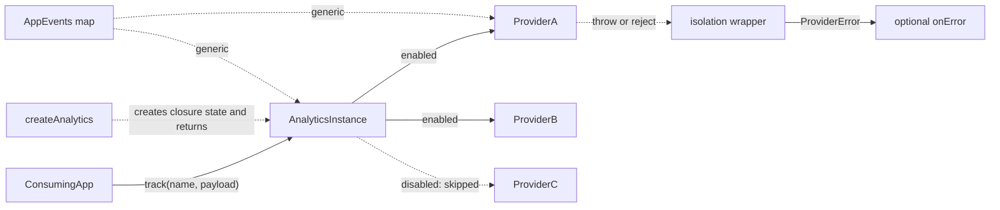
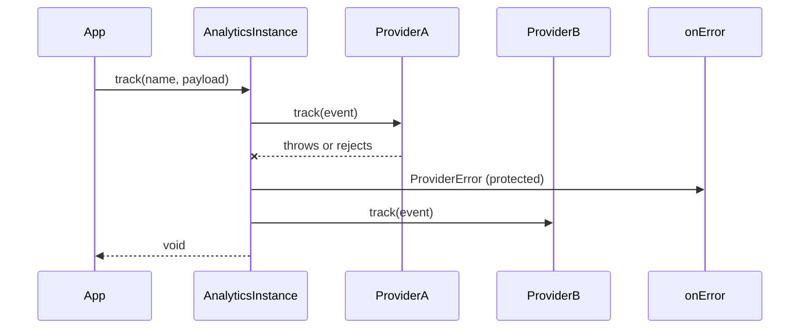

# box-multi-tracker: Architecture

Status: design only (no implementation yet).
Scope: Senior Frontend take-home. The goal is a small, clean, well-tested core with a type-safe API, not a production analytics platform.

## 1. Summary

`box-multi-tracker` is a standalone, framework-agnostic TypeScript library with zero runtime dependencies. It does two things:

1. Defines the **provider contract** (`AnalyticsProvider`).
2. **Dispatches** each tracked event to every enabled provider, isolating failures.

Everything else lives outside Core:

- Vendor SDKs (GTM, Yandex Metrica, Mixpanel, ...).
- Vendor name and payload mapping.
- Provider configuration.
- Business event names and payload types.

**Pattern:** a factory function (`createAnalytics`) that encapsulates per-instance state in a closure and returns a small facade (`AnalyticsInstance`), plus Strategy (`AnalyticsProvider`) with Dependency Injection through the factory configuration. Dispatch is a plain loop. No classes in Core, no event bus, no registry, no singleton, no module-level state.

**30-second interview pitch:** "Core knows nothing about vendors. The app declares an event map, implements providers against that map, and injects them through `createAnalytics`. The factory keeps its providers, enabled flags and `onError` in a closure and returns four functions that operate on that state. `track()` loops over enabled providers and calls each inside an isolation wrapper that handles sync throws and async rejections. A failing provider can't affect the others or the app, and two instances never share state."



## 2. Responsibilities and boundaries

**Core owns**
- The `AnalyticsProvider` contract and event types.
- The `createAnalytics` factory and the `AnalyticsInstance` it returns: `track`, provider enable/disable/query.
- Fan-out dispatch in registration order.
- Sync and async error isolation, plus the optional `onError` hook.

**Core does NOT own**
- Any vendor code or dependency.
- Event names or payload types (the app defines them).
- Name or payload mapping to vendors (inside each provider).
- Provider configuration (inside each provider's own setup, for example its constructor or factory).
- Browser, Node, or framework APIs. The `tsconfig` uses `lib: ["ES2022"]` without `DOM`, so accidental browser API use fails to compile. Tests run in the `node` environment.
- Init/lifecycle, buffering, retries, batching, timeouts, persistence. All out of scope for v1.

**Extensibility:** adding a provider means writing an object or class that implements `AnalyticsProvider` in the consuming app or a separate package, then adding it to `providers`. No Core change.

## 3. Provider contract

Minimal on purpose: a unique `name` and a `track` method that may be sync or async.

```ts
// illustrative, not implementation
type EventMap<T> = { [K in keyof T]: object | undefined };

// Readonly envelope; payload is shallow-readonly (Readonly<undefined> is just undefined)
type AnalyticsEvent<T extends EventMap<T>> = {
  [K in keyof T & string]: {
    readonly name: K;
    readonly payload: Readonly<T[K]>;
  };
}[keyof T & string];

interface AnalyticsProvider<T extends EventMap<T> = DefaultEvents> {
  readonly name: string;
  track(event: AnalyticsEvent<T>): void | Promise<void>;
}
```

**Decisions and why**
- **Single event object instead of `track(name, payload)`.** It is a discriminated union, so a typed provider can `switch (event.name)` and get a narrowed `payload` per case. The contract can also grow later without breaking providers. Alternative (positional generic method): simpler to read, but narrowing inside providers is awkward.
- **`name` is required and unique.** It is the key for runtime enable/disable and for error attribution. No other way to address a provider is needed.
- **No `init/identify/reset/flush/shutdown`.** None are required by the assignment. A provider that needs setup does it in its own constructor or factory. Adding optional methods later is non-breaking.
- **No timestamp or id in the event.** Providers can add their own. Core stays free of clocks and ID generation.
- **Readonly event and payload.** `name` and `payload` are `readonly`, and the payload is `Readonly<...>` (shallow). A provider that tries to assign to them fails to compile. This is a type-level guard only; see 5.4.
- **`EventMap<T>` self-referential constraint.** This is the one non-obvious type trick. It lets plain `interface AppEvents` work, because interfaces do not satisfy `Record<string, ...>` index signatures. It is defined once and reused.
- **`DefaultEvents = Record<string, object | undefined>`.** It allows untyped usage, and a provider written for "any event" is assignable to a typed `createAnalytics<AppEvents>(...)` configuration.
- **Method syntax on the interface.** This keeps parameter bivariance-friendly assignability for generic providers.

## 4. Public API

```ts
// illustrative, not implementation
interface ProviderEntry<T extends EventMap<T>> {
  provider: AnalyticsProvider<T>;
  enabled?: boolean;                 // default true
}

interface AnalyticsConfig<T extends EventMap<T>> {
  providers: ReadonlyArray<ProviderEntry<T>>;
  onError?: (error: ProviderError) => void;
}

interface ProviderError {
  providerName: string;
  eventName: string;
  error: unknown;                    // whatever the provider threw or rejected with
}

function createAnalytics<T extends EventMap<T> = DefaultEvents>(
  config: AnalyticsConfig<T>,
): AnalyticsInstance<T>;

interface AnalyticsInstance<T extends EventMap<T> = DefaultEvents> {
  track<K extends keyof T & string>(name: K, ...args: TrackArgs<T, K>): void;
  enableProvider(name: string): void;
  disableProvider(name: string): void;
  isProviderEnabled(name: string): boolean;
}

// payload is required unless the event's payload type includes undefined
type TrackArgs<T, K extends keyof T> =
  undefined extends T[K] ? [payload?: T[K]] : [payload: T[K]];
```

**Usage (consuming app)**

```ts
interface AppEvents {
  user_registered: { userId: string };
  order_created: { orderId: string; amount: number };
  logout: undefined;
}

// googleAnalytics and mixpanel are AnalyticsProvider<AppEvents> values built by the app
// (an object or a class instance); each has a unique `name`.
const analytics = createAnalytics<AppEvents>({
  providers: [
    { provider: googleAnalytics },
    { provider: mixpanel, enabled: false },
  ],
  onError: ({ providerName, eventName, error }) => report(providerName, eventName, error),
});

analytics.track("user_registered", { userId: "123" });
analytics.track("logout");

analytics.enableProvider("mixpanel");
analytics.disableProvider("mixpanel");
analytics.isProviderEnabled("mixpanel"); // false
```

**Compile-time guarantees**
- Unknown event names are rejected.
- Required payloads are enforced and wrong payload shapes are rejected.
- Payloadless events take no second argument. Optional-payload events (`T | undefined`) may omit it.
- A provider typed for a different event map cannot be injected. A generic (untyped) provider can.

**Exports from `index.ts`**
- Value: `createAnalytics`.
- Types: `AnalyticsInstance`, `AnalyticsProvider`, `AnalyticsEvent`, `AnalyticsConfig`, `ProviderEntry`, `ProviderError`, `EventMap`.
- Nothing else. `TrackArgs` and internals stay private.

**Improvements over the original conceptual example**
- The event map is an explicit generic (`createAnalytics<AppEvents>`) because TypeScript cannot reliably infer it from providers.
- `providers` entries are a single uniform shape, `{ provider, enabled? }`, so there are no bare-or-wrapped unions and no runtime type guards.

**Instance state and encapsulation (closure)**

Each `createAnalytics` call creates its own private scope. Inside it, the factory:
- Validates the configuration (duplicate provider names throw here, which is the construction step).
- Builds the instance's private state from `config`, and nothing else holds it: the registered providers with their enabled flags (a name-keyed collection that preserves registration order) and the `onError` callback.
- Returns an `AnalyticsInstance` whose four functions close over that state.

Rules:
- **All mutable state lives inside the factory call.** Module-level code in `analytics.ts` holds only stateless helpers (for example the error-isolation and reporting functions, which receive what they need as arguments). There are no module-level variables that change, no global registry, and no singleton.
- **No `this`.** The returned functions never depend on how they are called, so `const { track } = analytics` or passing `analytics.track` as a callback is safe.
- **State is unreachable except through the four methods.** There is no exposed provider list or flag store.
- **`config.providers` is read once, at construction.** Mutating the original array later does not change the instance.
- **Independence:** two calls create two closures, so instances never share state.

```ts
const analyticsA = createAnalytics<AppEvents>(configA);
const analyticsB = createAnalytics<AppEvents>(configB);

analyticsA.disableProvider("mixpanel");
analyticsB.isProviderEnabled("mixpanel"); // unaffected by the line above
```

**Why a factory instead of a class (trade-offs)**
- Why: true privacy of state without `#private` or naming conventions, no `this`-binding pitfalls, and a smaller surface with no subclassing to design for. The public type is an interface, so consumers and tests depend on `AnalyticsInstance<T>` rather than a concrete class.
- Cost: no `instanceof` checks and no prototype-based mocking. Each instance allocates its own four functions, which is negligible here. Tests mock providers, not the instance.

## 5. Behavior

### 5.1 `track` dispatch flow

1. Build the event `{ name, payload }`.
2. For each provider entry in registration order:
   - Skip if disabled.
   - Run the provider call as one guarded unit (see 5.3).
   - Any failure is reported to `onError` and dispatching continues.
3. Return `void`. Nothing is awaited and nothing is thrown.

The same event object is passed to every provider (no cloning).



### 5.2 Enable / disable
- The initial state comes from `ProviderEntry.enabled` (default `true`).
- `enableProvider` / `disableProvider` take effect on the next `track`.
- Events tracked while a provider is disabled are **dropped, not queued or replayed** (no buffering in v1, and it matches consent semantics).
- `isProviderEnabled(name)` returns the current state, and `false` for an unknown name.
- `enableProvider` / `disableProvider` with an unknown name **throw**. This is a programmer error, so it fails fast and catches typos.
- Duplicate provider names throw during construction (inside `createAnalytics`). This is required for name-based control to be unambiguous.
- An empty `providers` array is valid, and `track` is a no-op.

### 5.3 Error isolation

Each provider call is one guarded unit with two parts, plus a guarded reporter. `track` itself is never `async` and never `await`s, so it stays `void`.

1. **Call and normalize, inside a `try/catch`.** The provider call and the conversion of its return value both run inside the same `try`:
   - The provider throws synchronously: caught and reported **synchronously**.
   - It returns a non-thenable (`undefined`, or any unexpected value from untyped JS): ignored.
   - It returns anything else: it is normalized with `Promise.resolve(result)`. Doing this inside the `try` matters, because inspecting an unusual object can itself throw (for example a throwing `then` or `constructor` getter on a custom thenable).
2. **Observe the normalized promise with a rejection handler.** This covers:
   - Native rejected promises.
   - Custom thenables whose `then` throws or calls its reject callback. `Promise.resolve` converts these into a rejection, which is reported.
   - Thenables that call back more than once: only the first settlement counts.
   - Thenables that never settle: never reported, and harmless because nothing waits on them.
3. **The reporter cannot throw.** Both the `try/catch` and the rejection handler call the same reporter. The reporter calls `onError` inside its own `try/catch`, so a synchronous throw is swallowed. If `onError` returns a thenable (for example a consumer passed an `async` function), that thenable is also observed and its rejection swallowed. Because the reporter never throws, the promise chain derived from a provider never rejects, so there is no unhandled rejection.

Result: a failure anywhere in a provider's call, its returned value, or the error hook cannot escape and cannot skip the next provider.

Other points:
- **Default (no `onError`):** failures are silently ignored. Core has no logger and uses no `console`, so it stays environment-neutral.
- **`ProviderError` carries `providerName`, `eventName`, `error`.** `error` is `unknown`, because providers may throw non-`Error` values. The event payload is deliberately omitted so PII isn't forwarded to error sinks.
- **Why not an `async` wrapper:** `async () => provider.track(e)` gives one code path, but sync errors would be reported a microtask late. Explicit `try/catch` keeps sync reporting deterministic and easy to test.

### 5.4 Event immutability
- The event and its payload are readonly at the type level (section 3). This is **shallow**: nested objects inside a payload are not protected by the type.
- **Contract: providers must not mutate the received event or its payload.** All providers receive the same object, so a mutation would be visible to every later provider.
- Core does **not** deep clone and does **not** deep freeze. Cloning costs per event per provider and relies on runtime-specific APIs. Freezing would change runtime behavior for the app's own payload objects. The type-level guard plus the documented contract is the deliberate trade-off.

### 5.5 Deliberate scope decisions and known trade-offs

**Excluded on purpose.** This is a take-home, and each of these needs product decisions that the assignment does not specify:
- **Buffering, queues and lazy init:** they need policies (size caps, overflow, ordering) and a provider lifecycle state machine. Providers that need setup do it in their own constructor or factory and may buffer internally.
- **Retries and per-provider timeouts:** they need policy (which errors, how often, how long) and delivery guarantees. Failures are isolated and reported through `onError`, and the app or provider decides what to do.
- **Persistence, offline storage and batching:** these depend on a runtime (storage, network), which Core must not touch.
- **Lifecycle methods (`init/identify/reset/flush/shutdown`):** not required by the assignment.

**Known trade-offs (documented, not solved)**
- Async completion is not awaited, so there is no completion-order guarantee. Calls are issued in order.
- A hung async provider blocks nothing. A slow synchronous provider blocks the caller, which is the provider's responsibility.
- Events tracked while a provider is disabled are dropped, not replayed.
- A provider calling `analytics.track` from inside its own `track` can loop. This is unguarded and treated as a provider bug.

## 6. Project structure

```
box-multi-tracker/
  src/
    index.ts        # public exports only
    types.ts        # EventMap, AnalyticsEvent, AnalyticsProvider, config and error types
    analytics.ts    # createAnalytics factory: closure state, track, enable/disable, error isolation
  test/
    analytics.test.ts   # runtime behavior
    types.test-d.ts     # compile-time behavior
    helpers.ts          # recording / throwing / rejecting test providers
  ARCHITECTURE.md
  README.md             # usage and a sample custom provider snippet
  package.json  tsconfig.json  (vitest config if needed)
```

**Why this small:**
- `types.ts` and `analytics.ts` separate the contract (what providers and apps import) from behavior.
- Error isolation is about 15 lines. A separate file or `ErrorHandler` abstraction would be a layer without a reason, so it stays a small stateless helper inside `analytics.ts`.
- There is no `utils/`, `core/`, `providers/`, `internal/`, or `testing/` folder.
- Tooling: TypeScript, Vitest, `tsc` for the build, **ESM-only** output with an `exports` map and `types`.
- The sample custom provider is a snippet in `README.md`. Test helpers contain their own small providers; there is no `examples/` folder.

## 7. Testing strategy

**Runtime tests (`analytics.test.ts`, Vitest, `node` env)**
- Dispatch to multiple providers: all receive the event, in registration order.
- Event correctness: exact `name` and `payload` received; payloadless events deliver `undefined`.
- Enable/disable: disabled at construction, disable at runtime, re-enable, and `isProviderEnabled`.
- Unknown name: `enableProvider` / `disableProvider` throw; `isProviderEnabled` returns `false`.
- Duplicate provider names throw during construction (when `createAnalytics` is called).
- Empty `providers`: `track` doesn't throw and is a no-op.
- Instance independence: two instances created from separate configs (including the same provider names) track, enable and disable independently. Disabling a provider on one does not affect the other, and events tracked on one reach only its own providers.
- Closure behavior: methods work when destructured or passed as callbacks (no `this` dependency), and mutating the original `config.providers` array after creation does not change the instance.
- Sync failure: a provider throws, the others still receive the event, `track` doesn't throw, and `onError` gets `{ providerName, eventName, error }`.
- Async failure: a provider rejects, the others still receive the event, no unhandled rejection, and `onError` is called after the promise settles.
- Unusual thenables: a custom thenable whose `then` throws, one that rejects, one that settles multiple times, and one whose property access throws. All are isolated and reported at most once, with no unhandled rejection.
- Mixed sync and async providers, including a failing provider between two healthy ones.
- No `onError` configured: failures are silent and tracking continues.
- `onError` that throws, and `onError` that is an async function that rejects: neither breaks tracking or the remaining providers, and neither causes an unhandled rejection.
- A hung (never-resolving) async provider doesn't block other providers or `track`.
- Every provider receives the same event object (shared reference, no cloning).
- `track` returns `undefined` (void).

Unhandled rejections are verified by listening for the runtime's unhandled-rejection signal during the test and asserting none occurred.

**Type tests (`types.test-d.ts`, `expectTypeOf` / `@ts-expect-error`, run via Vitest typecheck).** The suite must explicitly cover these four areas:

1. **Interface-based event maps.**
   - `interface AppEvents {...}` (not just a `type` alias) is accepted by `createAnalytics<AppEvents>`, and the returned `AnalyticsInstance<AppEvents>` types `track` accordingly.
   - Valid event name and payload compile.
   - Unknown event names are errors.
   - Missing or wrong payloads are errors.
2. **`undefined` payloads.**
   - A payloadless event (`logout: undefined`) is callable with no payload.
   - An optional-payload event (`T | undefined`) may omit the payload or pass it.
   - A payloadless event rejects a provided payload.
3. **Generic providers.**
   - An untyped provider (default `DefaultEvents`) is accepted by `createAnalytics<AppEvents>`.
   - A provider typed for a different event map is rejected.
   - A provider typed for `AppEvents` is accepted.
4. **Discriminated-union narrowing.**
   - Inside a typed provider, `switch (event.name)` narrows `event.payload` to the matching payload type per case.
   - An exhaustiveness check over event names compiles when all cases are handled.

Plus readonly checks: assigning to `event.name`, `event.payload`, or a top-level payload property inside a provider is a compile error.

**Explicitly not tested:** package-compatibility matrices, publish checks, and bundle-size budgets.

## 8. Requirement traceability (is anything unnecessary?)

- Central tracking API: `AnalyticsInstance.track`, returned by `createAnalytics`.
- Multiple providers: `providers` array and the dispatch loop.
- Provider contract: `AnalyticsProvider`.
- Type-safe names and payloads: `EventMap`, `AnalyticsEvent`, `TrackArgs`.
- Dependency injection: `AnalyticsConfig.providers`, passed to `createAnalytics`.
- Independent instances without globals: closure state inside `createAnalytics`.
- Enable/disable (config and runtime), and query: `ProviderEntry.enabled`, `enableProvider`, `disableProvider`, `isProviderEnabled`.
- Failure isolation, sync and async: private isolation logic in `analytics.ts`.
- Optional `onError`, which cannot break tracking: `onError` plus its wrapper.
- Sync and async providers: the `void | Promise<void>` return type.
- Unit and type tests: `test/`.

Duplicate-name validation exists only because name-based control requires uniqueness. Everything in Core maps to a stated requirement.

## 9. Final decisions

1. **Provider configuration shape:** `{ provider, enabled? }` entries, with `enabled` defaulting to `true`. One uniform shape, no runtime type guard.
2. **Unknown provider names:** `enableProvider` / `disableProvider` throw. `isProviderEnabled` returns `false`.
3. **Duplicate provider names:** throw during construction (inside `createAnalytics`).
4. **Module format:** ESM-only, built with `tsc`.
5. **Sample provider:** a snippet in `README.md`; no `examples/` folder.
6. **`ProviderError`:** `{ providerName, eventName, error }`; no event payload.
7. **Event immutability:** readonly envelope and shallow-readonly payload at the type level; providers must not mutate; no deep clone and no deep freeze.
8. **Async isolation:** guarded call plus `Promise.resolve` normalization inside `try/catch`, rejection handler, and a reporter that cannot throw. `track(): void`.
9. **Scope:** no buffering, retries, persistence, batching, timeouts or lifecycle methods. These are deliberate scope decisions (5.5).
10. **Construction pattern:** functional factory `createAnalytics<AppEvents>(config)` returning `AnalyticsInstance<AppEvents>`, with per-instance state in a closure. No class, no `this`, no module-level mutable state, no singleton. This replaces the earlier class-based `Analytics`; the API surface, types and behavior are otherwise unchanged.
