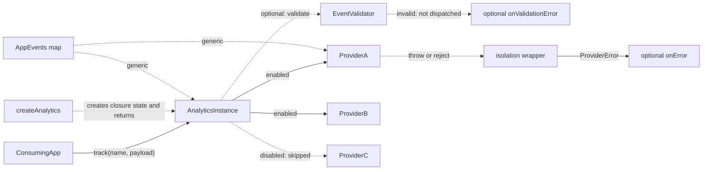
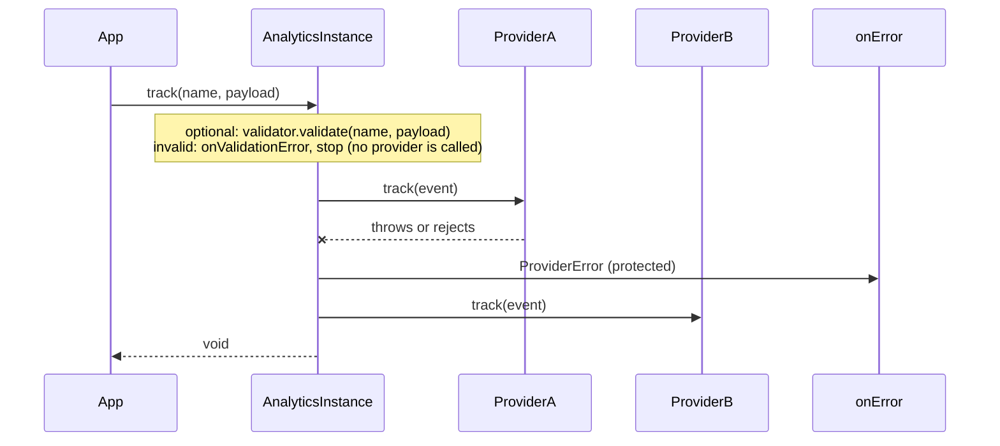

# box-multi-tracker: Architecture

Status: implemented. Optional runtime validation (section 5.6) and the optional Sentry adapter (section 5.7) were added after the first implementation; neither changes Core's tracking or error handling.
Scope: Senior Frontend take-home. The goal is a small, clean, well-tested core with a type-safe API, not a production analytics platform.

## 1. Summary

`box-multi-tracker` is a standalone, framework-agnostic TypeScript library with zero runtime dependencies. It does three things:

1. Defines the **provider contract** (`AnalyticsProvider`).
2. **Dispatches** each tracked event to every enabled provider, isolating failures.
3. Optionally **validates** each payload through an injected, library-independent `EventValidator` before dispatch (5.6).

Everything else lives outside Core:

- Vendor SDKs (GTM, Yandex Metrica, Mixpanel, ...).
- Vendor name and payload mapping.
- Provider configuration.
- Business event names and payload types.
- Any validation library. Core only knows the `EventValidator` contract; Zod is an optional adapter in its own entry point (`box-multi-tracker/zod`).
- Any monitoring service. Core only exposes `onError` and `onValidationError`; Sentry is an optional adapter in its own entry point (`box-multi-tracker/sentry`).

**Pattern:** a factory function (`createAnalytics`) that encapsulates per-instance state in a closure and returns a small facade (`AnalyticsInstance`), plus Strategy (`AnalyticsProvider`) with Dependency Injection through the factory configuration. Dispatch is a plain loop. No classes in Core, no event bus, no registry, no singleton, no module-level state.

**30-second interview pitch:** "Core knows nothing about vendors. The app declares an event map, implements providers against that map, and injects them through `createAnalytics`. The factory keeps its providers, enabled flags and `onError` in a closure and returns four functions that operate on that state. `track()` loops over enabled providers and calls each inside an isolation wrapper that handles sync throws and async rejections. A failing provider can't affect the others or the app, and two instances never share state."



## 2. Responsibilities and boundaries

**Core owns**
- The `AnalyticsProvider` contract and event types.
- The `createAnalytics` factory and the `AnalyticsInstance` it returns: `track`, provider enable/disable/query.
- Fan-out dispatch in registration order.
- Sync and async error isolation, plus the optional `onError` hook.
- The `EventValidator` contract and the optional validation step before dispatch, plus the separate `onValidationError` hook (5.6).

**Core does NOT own**
- Any vendor code or dependency.
- Any validation library, or knowledge of one. Validation rules live in the app (or an adapter such as `box-multi-tracker/zod`), never in Core.
- Event names or payload types (the app defines them).
- Name or payload mapping to vendors (inside each provider).
- Provider configuration (inside each provider's own setup, for example its constructor or factory).
- Browser, Node, or framework APIs. The `tsconfig` uses `lib: ["ES2022"]` without `DOM`, so accidental browser API use fails to compile. Tests run in the `node` environment.
- Init/lifecycle, buffering, retries, batching, timeouts, persistence. All out of scope for v1.

**Extensibility:** adding a provider means writing an object or class that implements `AnalyticsProvider` in the consuming app or a separate package, then adding it to `providers`. No Core change.

## 3. Provider contract

Minimal on purpose: a unique `name` and a `track` method that may be sync or async.

```ts
// illustrative, not implementation
type EventMap<T> = { [K in keyof T]: object | undefined };

// Readonly envelope; payload is shallow-readonly (Readonly<undefined> is just undefined)
type AnalyticsEvent<T extends EventMap<T>> = {
  [K in keyof T & string]: {
    readonly name: K;
    readonly payload: Readonly<T[K]>;
  };
}[keyof T & string];

interface AnalyticsProvider<T extends EventMap<T> = DefaultEvents> {
  readonly name: string;
  track(event: AnalyticsEvent<T>): void | Promise<void>;
}
```

**Decisions and why**
- **Single event object instead of `track(name, payload)`.** It is a discriminated union, so a typed provider can `switch (event.name)` and get a narrowed `payload` per case. The contract can also grow later without breaking providers. Alternative (positional generic method): simpler to read, but narrowing inside providers is awkward.
- **`name` is required and unique.** It is the key for runtime enable/disable and for error attribution. No other way to address a provider is needed.
- **No `init/identify/reset/flush/shutdown`.** None are required by the assignment. A provider that needs setup does it in its own constructor or factory. Adding optional methods later is non-breaking.
- **No timestamp or id in the event.** Providers can add their own. Core stays free of clocks and ID generation.
- **Readonly event and payload.** `name` and `payload` are `readonly`, and the payload is `Readonly<...>` (shallow). A provider that tries to assign to them fails to compile. This is a type-level guard only; see 5.4.
- **`EventMap<T>` self-referential constraint.** This is the one non-obvious type trick. It lets plain `interface AppEvents` work, because interfaces do not satisfy `Record<string, ...>` index signatures. It is defined once and reused.
- **`DefaultEvents = Record<string, object | undefined>`.** It allows untyped usage, and a provider written for "any event" is assignable to a typed `createAnalytics<AppEvents>(...)` configuration.
- **Method syntax on the interface.** `track(event: AnalyticsEvent<T>): void | Promise<void>` is deliberately declared as a method, not a function-typed property. This keeps compatibility with generic providers that use `DefaultEvents`. See the provider event map contract below.

**Provider event map contract (accepted decision)**
- **Every provider accepts the complete application event map.** A provider injected into `createAnalytics<AppEvents>` is typed to receive `AnalyticsEvent<AppEvents>`, either as `AnalyticsProvider<AppEvents>` or as a generic `AnalyticsProvider` (`DefaultEvents`).
- **Core dispatches every event to every enabled provider.** It does not filter or route by provider capability, and there are no capability declarations, event filters or subscriptions.
- **A provider may handle only a subset of events.** It is responsible for ignoring the events it doesn't need, typically with a `switch (event.name)` that has no case for them. Mapping and filtering stay inside the provider, consistent with "Core does not own vendor mapping".
- **Method-parameter bivariance is accepted, not a feature.** Because `track` is a method, TypeScript checks its parameter bivariantly. As a result, a provider typed for a subset event map (for example `AnalyticsProvider<{ order_created: ... }>` where the app has more events) may also be assignable to `AnalyticsConfig<AppEvents>`. This is an acknowledged TypeScript behavior and is not a supported selective-subscription feature. Core still delivers all events to that provider, and it must tolerate those it doesn't recognize. Providers with disjoint event maps or conflicting payload types are still rejected.
- **Alternative (rejected for now):** declaring `track` as a function-typed property gives strict parameter contravariance and rejects subset providers. It would also change how generic `DefaultEvents` providers are checked, so the method syntax is retained.

## 4. Public API

```ts
// illustrative, not implementation
interface ProviderEntry<T extends EventMap<T>> {
  provider: AnalyticsProvider<T>;
  enabled?: boolean;                 // default true
}

// T: what providers receive. TInput: what `track` accepts (defaults to T).
// They only differ when a validator transforms payloads (5.6).
interface AnalyticsConfig<T extends EventMap<T>, TInput extends EventMap<TInput> = T> {
  providers: ReadonlyArray<ProviderEntry<T>>;
  onError?: (error: ProviderError) => void;
  validator?: EventValidator<TInput, T>;                       // optional, see 5.6
  onValidationError?: (error: ValidationError) => void;        // optional, see 5.6
}

interface ProviderError {
  providerName: string;
  eventName: string;
  error: unknown;                    // whatever the provider threw or rejected with
}

// Two overloads (the validator overload is first on purpose, see 5.6).
function createAnalytics<T extends EventMap<T>, TInput extends EventMap<TInput>>(
  config: AnalyticsConfig<T, TInput> & { validator: EventValidator<TInput, T> },
): AnalyticsInstance<T, TInput>;
function createAnalytics<T extends EventMap<T> = DefaultEvents>(
  config: AnalyticsConfig<T>,
): AnalyticsInstance<T>;

interface AnalyticsInstance<T extends EventMap<T> = DefaultEvents, TInput extends EventMap<TInput> = T> {
  track<K extends keyof T & keyof TInput & string>(name: K, ...args: TrackArgs<TInput, K>): void;
  enableProvider(name: string): void;
  disableProvider(name: string): void;
  isProviderEnabled(name: string): boolean;
}

// payload is required unless the event's payload type includes undefined
type TrackArgs<T, K extends keyof T> =
  undefined extends T[K] ? [payload?: T[K]] : [payload: T[K]];
```

**Usage (consuming app)**

```ts
interface AppEvents {
  user_registered: { userId: string };
  order_created: { orderId: string; amount: number };
  logout: undefined;
}

// googleAnalytics and mixpanel are AnalyticsProvider<AppEvents> values built by the app
// (an object or a class instance); each has a unique `name`.
const analytics = createAnalytics<AppEvents>({
  providers: [
    { provider: googleAnalytics },
    { provider: mixpanel, enabled: false },
  ],
  onError: ({ providerName, eventName, error }) => report(providerName, eventName, error),
});

analytics.track("user_registered", { userId: "123" });
analytics.track("logout");

analytics.enableProvider("mixpanel");
analytics.disableProvider("mixpanel");
analytics.isProviderEnabled("mixpanel"); // false
```

**Compile-time guarantees**
- Unknown event names are rejected.
- Required payloads are enforced and wrong payload shapes are rejected.
- Payloadless events take no second argument. Optional-payload events (`T | undefined`) may omit it.
- A provider typed for a different event map cannot be injected. A generic (untyped) provider can.

**Exports from `index.ts`**
- Value: `createAnalytics`.
- Types: `AnalyticsInstance`, `AnalyticsProvider`, `AnalyticsEvent`, `AnalyticsConfig`, `ProviderEntry`, `ProviderError`, `EventMap`, `EventValidator`, `ValidationResult`, `ValidationIssue`, `ValidationError`.
- Nothing else. `TrackArgs` and internals stay private.

**Exports from `box-multi-tracker/zod` (separate entry point, optional)**
- Value: `createZodValidator`.
- Types: `ZodEventSchemas`, `InferInputEvents`, `InferOutputEvents`.
- Importing this entry point is the only place `zod` is referenced, and only as types.

**Exports from `box-multi-tracker/sentry` (separate entry point, optional)**
- Value: `createSentryReporter`.
- Types: `SentryReporter`, `SentryReporterOptions` (only Core types appear in them; no Sentry type is exposed).
- Importing this entry point is the only place `@sentry/browser` is referenced, and it is a runtime import.

**Improvements over the original conceptual example**
- The event map is an explicit generic (`createAnalytics<AppEvents>`) because TypeScript cannot reliably infer it from providers.
- `providers` entries are a single uniform shape, `{ provider, enabled? }`, so there are no bare-or-wrapped unions and no runtime type guards.

**Instance state and encapsulation (closure)**

Each `createAnalytics` call creates its own private scope. Inside it, the factory:
- Validates the configuration (duplicate provider names throw here, which is the construction step).
- Builds the instance's private state from `config`, and nothing else holds it: the registered providers with their enabled flags (a name-keyed collection that preserves registration order) and the `onError` callback.
- Returns an `AnalyticsInstance` whose four functions close over that state.

Rules:
- **All mutable state lives inside the factory call.** Module-level code in `analytics.ts` holds only stateless helpers (for example the error-isolation and reporting functions, which receive what they need as arguments). There are no module-level variables that change, no global registry, and no singleton.
- **No `this`.** The returned functions never depend on how they are called, so `const { track } = analytics` or passing `analytics.track` as a callback is safe.
- **State is unreachable except through the four methods.** There is no exposed provider list or flag store.
- **`config.providers` is read once, at construction.** Mutating the original array later does not change the instance.
- **Independence:** two calls create two closures, so instances never share state.

```ts
const analyticsA = createAnalytics<AppEvents>(configA);
const analyticsB = createAnalytics<AppEvents>(configB);

analyticsA.disableProvider("mixpanel");
analyticsB.isProviderEnabled("mixpanel"); // unaffected by the line above
```

**Why a factory instead of a class (trade-offs)**
- Why: true privacy of state without `#private` or naming conventions, no `this`-binding pitfalls, and a smaller surface with no subclassing to design for. The public type is an interface, so consumers and tests depend on `AnalyticsInstance<T>` rather than a concrete class.
- Cost: no `instanceof` checks and no prototype-based mocking. Each instance allocates its own four functions, which is negligible here. Tests mock providers, not the instance.

## 5. Behavior

### 5.1 `track` dispatch flow

1. **If a `validator` is configured**, validate the payload first (5.6). A rejected payload is reported to `onValidationError` and `track` returns: no provider is called. An accepted payload is replaced by the validator's output (possibly transformed). Without a validator this step does not exist and the payload is used unchanged.
2. Build the event `{ name, payload }`.
3. For each provider entry in registration order:
   - Skip if disabled.
   - Run the provider call as one guarded unit (see 5.3).
   - Any failure is reported to `onError` and dispatching continues.
4. Return `void`. Nothing is awaited and nothing is thrown.

The same event object is passed to every provider (no cloning).



### 5.2 Enable / disable
- The initial state comes from `ProviderEntry.enabled` (default `true`).
- `enableProvider` / `disableProvider` take effect on the next `track`.
- Events tracked while a provider is disabled are **dropped, not queued or replayed** (no buffering in v1, and it matches consent semantics).
- `isProviderEnabled(name)` returns the current state, and `false` for an unknown name.
- `enableProvider` / `disableProvider` with an unknown name **throw**. This is a programmer error, so it fails fast and catches typos.
- Duplicate provider names throw during construction (inside `createAnalytics`). This is required for name-based control to be unambiguous.
- An empty `providers` array is valid, and `track` is a no-op.

### 5.3 Error isolation

Each provider call is one guarded unit with two parts, plus a guarded reporter. `track` itself is never `async` and never `await`s, so it stays `void`.

1. **Call and normalize, inside a `try/catch`.** The provider call and the conversion of its return value both run inside the same `try`:
   - The provider throws synchronously: caught and reported **synchronously**.
   - It returns a non-thenable (`undefined`, or any unexpected value from untyped JS): ignored.
   - It returns anything else: it is normalized with `Promise.resolve(result)`. Doing this inside the `try` matters, because inspecting an unusual object can itself throw (for example a throwing `then` or `constructor` getter on a custom thenable).
2. **Observe the normalized promise with a rejection handler.** This covers:
   - Native rejected promises.
   - Custom thenables whose `then` throws or calls its reject callback. `Promise.resolve` converts these into a rejection, which is reported.
   - Thenables that call back more than once: only the first settlement counts.
   - Thenables that never settle: never reported, and harmless because nothing waits on them.
3. **The reporter cannot throw.** Both the `try/catch` and the rejection handler call the same reporter. The reporter calls `onError` inside its own `try/catch`, so a synchronous throw is swallowed. If `onError` returns a thenable (for example a consumer passed an `async` function), that thenable is also observed and its rejection swallowed. Because the reporter never throws, the promise chain derived from a provider never rejects, so there is no unhandled rejection.

Result: a failure anywhere in a provider's call, its returned value, or the error hook cannot escape and cannot skip the next provider.

Other points:
- **Default (no `onError`):** failures are silently ignored. Core has no logger and uses no `console`, so it stays environment-neutral.
- **`ProviderError` carries `providerName`, `eventName`, `error`.** `error` is `unknown`, because providers may throw non-`Error` values. The event payload is deliberately omitted so PII isn't forwarded to error sinks.
- **Why not an `async` wrapper:** `async () => provider.track(e)` gives one code path, but sync errors would be reported a microtask late. Explicit `try/catch` keeps sync reporting deterministic and easy to test.

### 5.4 Event immutability
- The event and its payload are readonly at the type level (section 3). This is **shallow**: nested objects inside a payload are not protected by the type.
- **Contract: providers must not mutate the received event or its payload.** All providers receive the same object, so a mutation would be visible to every later provider.
- Core does **not** deep clone and does **not** deep freeze. Cloning costs per event per provider and relies on runtime-specific APIs. Freezing would change runtime behavior for the app's own payload objects. The type-level guard plus the documented contract is the deliberate trade-off.

### 5.5 Deliberate scope decisions and known trade-offs

**Excluded on purpose.** This is a take-home, and each of these needs product decisions that the assignment does not specify:
- **Buffering, queues and lazy init:** they need policies (size caps, overflow, ordering) and a provider lifecycle state machine. Providers that need setup do it in their own constructor or factory and may buffer internally.
- **Retries and per-provider timeouts:** they need policy (which errors, how often, how long) and delivery guarantees. Failures are isolated and reported through `onError`, and the app or provider decides what to do.
- **Persistence, offline storage and batching:** these depend on a runtime (storage, network), which Core must not touch.
- **Lifecycle methods (`init/identify/reset/flush/shutdown`):** not required by the assignment.

**Known trade-offs (documented, not solved)**
- Async completion is not awaited, so there is no completion-order guarantee. Calls are issued in order.
- A hung async provider blocks nothing. A slow synchronous provider blocks the caller, which is the provider's responsibility.
- Events tracked while a provider is disabled are dropped, not replayed.
- A provider calling `analytics.track` from inside its own `track` can loop. This is unguarded and treated as a provider bug.

### 5.6 Runtime validation (optional)

TypeScript checks events at compile time only. Data that reaches `track` from outside the type system (a form field, a URL parameter, an API response) is not covered. Runtime validation closes that gap, and can also normalize payloads before any provider sees them.

**Why validation is optional.** Many consumers already have trustworthy types and do not want the cost or the dependency. Without a `validator`, `track` behaves exactly as before: no extra work, no behavior change, no new failure modes. Validation is a capability, not a requirement.

**The contract (Core, library-independent).**

```ts
interface ValidationIssue { readonly message: string; readonly path: ReadonlyArray<string | number> }

type ValidationResult<T> =
  | { readonly success: true; readonly data: T }
  | { readonly success: false; readonly issues: ReadonlyArray<ValidationIssue> };

interface EventValidator<TInput extends EventMap<TInput>, T extends EventMap<T> = TInput> {
  readonly validate: <K extends keyof TInput & keyof T & string>(
    name: K,
    payload: TInput[K],
  ) => ValidationResult<T[K]>;
}

interface ValidationError { eventName: string; issues: ReadonlyArray<ValidationIssue>; cause?: unknown }
```

It is deliberately small: one function, and a result that is plain data. No schema type, no library error type, no exception contract. Anything that can produce a `ValidationResult` can be a validator: a Zod adapter, a hand-written function, another schema library.

**Runtime decisions.**
- **Before dispatch, once per `track`.** The validator runs once, before the enabled-provider snapshot, so it also runs when every provider is disabled and the result is the same for every provider.
- **A failed validation reaches no provider.** The event is reported to `onValidationError` (if configured) and dropped. Disabled and enabled providers alike never see it.
- **A successful validation replaces the payload.** Providers receive `result.data`, so a transformation (`{ total: "500" }` becomes `{ total: 500 }`) is what they get. Every provider receives the same transformed object, as before.
- **Validation errors are not provider errors.** They go to a dedicated `onValidationError`, never to `onError`. `ProviderError` means "a provider failed"; `ValidationError` means "the event was rejected before any provider ran". The two callbacks have different causes and different remedies, so they are kept apart.
- **Neither callback can break the SDK.** `onValidationError` goes through the same never-throwing reporter as `onError`: a sync throw is swallowed, and an async rejection or odd thenable is observed, so there is no unhandled rejection.
- **A misbehaving validator fails closed.** If `validate` throws, or returns something that is not a `ValidationResult`, the event is dropped and reported with one issue (`Validator threw: ...`) and the underlying error in `cause`. Silently dispatching unvalidated data after a validator bug would defeat the purpose of validating. `cause` is set only in this case.
- **No payload in `ValidationError`.** Like `ProviderError`, it carries the event name and the issues, not the payload, so PII is not forwarded to error sinks. Issue messages come from the validator and are the validator's responsibility.
- **Configuration is snapshotted at construction**, like the providers. Two instances can use different validators and never share state.
- **No buffering, retries, batching or persistence.** A rejected event is gone, as is an event for a disabled provider.

**Typing.** Validation can change a payload's type, so there are two event maps: `T` is what providers receive, `TInput` is what `track` accepts.
- `AnalyticsInstance<T, TInput = T>` and `AnalyticsConfig<T, TInput = T>` carry both. With no validator, `TInput = T` and every existing signature is unchanged.
- `EventValidator<TInput, T>` goes from input to output, as the data does.
- `createAnalytics({ providers, validator })` infers both maps from the validator, so callers rarely write them.
- `validate` is a function-typed property (strict parameter checking), so a validator that does not cover every event, or produces the wrong output type, is a compile error. Transformed values are never cast to the original event type.
- **Overload order matters.** The overload that requires a `validator` comes first. A validator that accepts a wider input than it produces (`string | number` in, `number` out) is also assignable to a validator with identical input and output; if the plain overload came first it would win and silently narrow `track` to the output types. A type test locks this in.
- Giving two type arguments without a validator is a compile error (there would be no way to turn the input into the output).

**The Zod adapter (`box-multi-tracker/zod`).**

```ts
const validator = createZodValidator({
  order_created: z.object({ orderId: z.string(), total: z.coerce.number() }),
  logout: z.undefined(),
});
// EventValidator<{ order_created: { orderId: string; total: unknown }; ... }, { ... total: number ... }>
```

- **Why an adapter and not part of Core.** Core's promise is "no runtime dependencies, no knowledge of any vendor". A hard Zod dependency would break that and tie every consumer to one library and one major version. The contract above lets Core stay ignorant and lets any library plug in.
- **Separate entry point, not a separate package.** `box-multi-tracker/zod` lives in the same package (`exports["./zod"]`) so it is versioned with the contract it implements and needs no second publish. Importing `box-multi-tracker` never loads it, and `sideEffects: false` keeps unused code out of bundles.
- **Optional peer dependency.** `zod` is a `peerDependency` (`^4.0.0`) marked optional in `peerDependenciesMeta`, so installing the SDK never installs Zod and consumers who do not import the adapter never need it. It is a `devDependency` here so tests can run. `dependencies` stays empty.
- **No runtime import of Zod.** The adapter only does `import type { input, output, ZodType } from "zod"`; the emitted JavaScript has no import at all. It calls `schema.safeParse(...)` on the schemas the consumer passes in.
- **What it does.** One schema per event (an object mapping event names to schemas). Input and output types are inferred from the schemas (`z.input` / `z.output`), so transforms, defaults and coercion type-check. A Zod failure becomes a plain `{ success: false, issues }` with only `message` and `path` (symbol path segments are stringified); no `ZodError` leaves the adapter. An event name with no schema is a failed validation (`No validation schema registered for ...`), not an exception, and inherited property names such as `toString` do not count as registered.
- **Zod 4 only, synchronous only.** The adapter targets Zod 4 types. Async schemas (async refinements) make `safeParse` throw; that becomes a validator failure and the event is dropped, consistent with fail-closed. `track` is synchronous, and awaiting validation would add ordering and buffering questions that are out of scope.
- **One localized cast.** Zod's output type is not provably the mapped output type at the point where one schema is picked by a generic key, so `result.data` is asserted once, inside the adapter, with a comment. The public types remain exact, and nothing in Core uses `any`.

**Trade-offs.**
- Two generics (`T`, `TInput`) add some surface. They are invisible when no validator is used and are normally inferred when one is.
- With an overload set, a type error in a `createAnalytics` call can mention the overload that was tried last, which reads less clearly than a single signature.
- A rejected event is silent unless `onValidationError` is set, matching `onError`.
- Each `track` pays for one validator call when a validator is configured, and nothing otherwise.

### 5.7 Sentry adapter (optional)

`box-multi-tracker/sentry` reports failures of the SDK to Sentry. Core is unchanged: the adapter is a pair of handlers for the callbacks that already exist.

```ts
const sentry = createSentryReporter({ instanceId: "checkout" });
createAnalytics({ providers, onError: sentry.onProviderError, onValidationError: sentry.onValidationError });
```

- **Separate entry point.** `exports["./sentry"]`, same package. Nothing in Core imports it; no `@sentry` string appears in Core's source or output. This is checked by searching the Core source and the build output.
- **Optional peer dependency.** `@sentry/browser` `^11.0.0`, optional in `peerDependenciesMeta`; also a `devDependency` for tests. Importing the subpath without it installed fails at module load (`ERR_MODULE_NOT_FOUND`); Core and the Zod adapter are unaffected.
- **Never initializes Sentry.** The application calls `Sentry.init`. The reporter only calls `captureException`. No `init`, `flush`, retry, queue or lifecycle.
- **Functional factory, no state.** `createSentryReporter({ instanceId })` returns two handlers over a closure of one string. No class, no module-level state.
- **Policy.**

| Source | Reported | Why |
| --- | --- | --- |
| Provider throws or rejects (`ProviderError`) | yes | a bug or outage in an integration |
| Validator throws (`ValidationError` with a `cause` property) | yes | a bug in the validator |
| Payload fails validation (no `cause` property) | no | expected input, not a defect; still visible through `onValidationError` |

- **Classification by `Object.hasOwn(error, "cause")`.** A validator can throw `undefined`, so `cause !== undefined` would misclassify it. The presence of the property is the signal, and it is set only in Core's catch path.
- **Tags** `source=box-multi-tracker`, `instance`, `error_type` (`provider_error` or `validator_exception`), `event`, and `provider` for provider errors. A `box_multi_tracker` context carries `thrown_value_was_error` and, for validator exceptions, `issue_count`.
- **Privacy by construction.** The handlers receive only `ProviderError` and `ValidationError`, which carry no payload. A thrown value that is not an `Error` is replaced by a fixed message, because it can contain payload data. Validation issue text is dropped (only the count is sent): Core builds a failed-validator issue from the thrown value, and Sentry's context depth limit would flatten it anyway.
- **Isolation.** The handlers never throw: argument destructuring and the Sentry call are inside one `try/catch`. If `captureException` returns something promise-like, a rejection handler is attached so a failing send cannot become an unhandled rejection. Sentry's own failures are swallowed and never reported again.

**Trade-offs.**
- A provider's own `Error` is sent with its message. Providers and validators must not put payload data in error messages.
- Sentry's default integrations (console, click and fetch breadcrumbs) can attach logged payloads to events. That is Sentry configuration, outside the adapter; the README and the playground disable them.
- Validator failures are told apart by the `cause` property, so they depend on Core attaching it for exceptions only (current behavior, covered by tests).
- Only `@sentry/browser` 11.13 was verified; the `^11.0.0` range is not.

## 6. Project structure

```
box-multi-tracker/
  src/
    index.ts        # public exports only
    types.ts        # EventMap, AnalyticsEvent, AnalyticsProvider, config, validator and error types
    analytics.ts    # createAnalytics factory: closure state, validation step, track, enable/disable, error isolation
    zod/
      index.ts      # entry point `box-multi-tracker/zod` (re-exports only)
      validator.ts  # createZodValidator: the only file that mentions Zod (type imports only)
    sentry/
      index.ts      # entry point `box-multi-tracker/sentry` (re-exports only)
      reporter.ts   # createSentryReporter: the only file that imports @sentry/browser
  test/
    analytics.test.ts       # runtime behavior
    types.test-d.ts         # compile-time behavior
    validation.test.ts      # Core validation, with a hand-written validator (no Zod)
    validation.test-d.ts    # validation typing in Core
    zod.test.ts             # Zod adapter, alone and end to end through createAnalytics
    zod.test-d.ts           # Zod adapter typing and public exports
    sentry.test.ts          # Sentry adapter against a mocked @sentry/browser
    sentry.integration.test.ts  # Sentry adapter against the real client with an in-memory transport
    sentry.test-d.ts        # Sentry adapter typing and public exports
    helpers.ts              # recording / throwing / rejecting test providers
  ARCHITECTURE.md
  README.md             # usage, validation, and a sample custom provider snippet
  package.json  tsconfig.json  (vitest config if needed)
```

**Why this small:**
- `types.ts` and `analytics.ts` separate the contract (what providers and apps import) from behavior.
- Error isolation is about 15 lines. A separate file or `ErrorHandler` abstraction would be a layer without a reason, so it stays a small stateless helper inside `analytics.ts`.
- `src/zod/` and `src/sentry/` are the only folders besides the top-level files. Each exists because the adapter is a separate public entry point; nothing outside it may import it, and nothing in it is imported by Core.
- There is no `utils/`, `core/`, `providers/`, `internal/`, or `testing/` folder.
- Tooling: TypeScript, Vitest, `tsc` for the build, **ESM-only** output with an `exports` map and `types`.
- The sample custom provider is a snippet in `README.md`. Test helpers contain their own small providers; there is no `examples/` folder.

## 7. Testing strategy

**Runtime tests (`analytics.test.ts`, Vitest, `node` env)**
- Dispatch to multiple providers: all receive the event, in registration order.
- Event correctness: exact `name` and `payload` received; payloadless events deliver `undefined`.
- Enable/disable: disabled at construction, disable at runtime, re-enable, and `isProviderEnabled`.
- Unknown name: `enableProvider` / `disableProvider` throw; `isProviderEnabled` returns `false`.
- Duplicate provider names throw during construction (when `createAnalytics` is called).
- Empty `providers`: `track` doesn't throw and is a no-op.
- Instance independence: two instances created from separate configs (including the same provider names) track, enable and disable independently. Disabling a provider on one does not affect the other, and events tracked on one reach only its own providers.
- Closure behavior: methods work when destructured or passed as callbacks (no `this` dependency), and mutating the original `config.providers` array after creation does not change the instance.
- Sync failure: a provider throws, the others still receive the event, `track` doesn't throw, and `onError` gets `{ providerName, eventName, error }`.
- Async failure: a provider rejects, the others still receive the event, no unhandled rejection, and `onError` is called after the promise settles.
- Unusual thenables: a custom thenable whose `then` throws, one that rejects, one that settles multiple times, and one whose property access throws. All are isolated and reported at most once, with no unhandled rejection.
- Mixed sync and async providers, including a failing provider between two healthy ones.
- No `onError` configured: failures are silent and tracking continues.
- `onError` that throws, and `onError` that is an async function that rejects: neither breaks tracking or the remaining providers, and neither causes an unhandled rejection.
- A hung (never-resolving) async provider doesn't block other providers or `track`.
- Every provider receives the same event object (shared reference, no cloning).
- `track` returns `undefined` (void).

Unhandled rejections are verified by listening for the runtime's unhandled-rejection signal during the test and asserting none occurred.

**Type tests (`types.test-d.ts`, `expectTypeOf` / `@ts-expect-error`, run via Vitest typecheck).** The suite must explicitly cover these four areas:

1. **Interface-based event maps.**
   - `interface AppEvents {...}` (not just a `type` alias) is accepted by `createAnalytics<AppEvents>`, and the returned `AnalyticsInstance<AppEvents>` types `track` accordingly.
   - Valid event name and payload compile.
   - Unknown event names are errors.
   - Missing or wrong payloads are errors.
2. **`undefined` payloads.**
   - A payloadless event (`logout: undefined`) is callable with no payload.
   - An optional-payload event (`T | undefined`) may omit the payload or pass it.
   - A payloadless event rejects a provided payload.
3. **Generic providers.**
   - An untyped provider (default `DefaultEvents`) is accepted by `createAnalytics<AppEvents>`.
   - A provider typed for a different event map is rejected.
   - A provider typed for `AppEvents` is accepted.
4. **Discriminated-union narrowing.**
   - Inside a typed provider, `switch (event.name)` narrows `event.payload` to the matching payload type per case.
   - An exhaustiveness check over event names compiles when all cases are handled.

Plus readonly checks: assigning to `event.name`, `event.payload`, or a top-level payload property inside a provider is a compile error.

**Validation runtime tests (`validation.test.ts`, no Zod).** A small hand-written validator proves Core depends only on the contract.
- No validator: behavior is unchanged and `onValidationError` is never called.
- Successful validation: providers receive the transformed payload; every provider gets the same event; the validator runs once, before any provider, and receives the event name and the original payload; payloadless events work.
- Failed validation: no provider receives the event (including disabled ones); `onValidationError` gets the event name and issues, synchronously, without the payload; `onError` is not called; later valid events still work; no callback means silent; validation still runs when every provider is disabled.
- Misbehaving validator: a throw, a non-`Error` throw and a non-result return all fail closed with `cause`.
- Failing `onValidationError`: sync throw, async rejection and an odd thenable are swallowed with no unhandled rejection.
- Provider isolation still works with a validator configured.
- Two instances with different validators are independent, and the configuration is snapshotted at construction.

**Zod adapter runtime tests (`zod.test.ts`).** Valid payloads; transformations (`"500"` to `500`, trim, default, lowercase); different schemas per event; optional and `undefined` payloads; the plain `{ success, issues }` shape with only `message` and `path`; nested paths and several issues; symbol path conversion; unknown events and inherited names (`toString`, `__proto__`) as failures; schemas are not mutated; and end to end through `createAnalytics` (the transformation example, validation error reporting, an async schema failing closed, two instances with different schemas).

**Sentry adapter tests (`sentry.test.ts`, `sentry.integration.test.ts`, `sentry.test-d.ts`).**
- Mocked `@sentry/browser` (a plain recorder, so an unobserved rejection stays unhandled and is detected): provider errors (sync and async) reported with exact tags, level and context; per-reporter instance tag; non-`Error` values replaced; validator exceptions reported, including a validator that throws `undefined`; ordinary validation failures not reported; no payload or issue text anywhere in captured arguments; end to end through `createAnalytics`.
- Isolation: a throwing `captureException`, a rejected promise, a thenable with a throwing `then` getter, a hostile `Proxy` and malformed arguments never escape or cause an unhandled rejection.
- Integration with the real client (dummy DSN, no default integrations, in-memory transport): the same policy, and a sentinel payload never appears in a serialized envelope. This caught the depth flattening of nested context, which a mock cannot show.
- Types: required `instanceId`, handler types equal Core's callback types, plug into `AnalyticsConfig`, and `createSentryReporter` is not exported from the Core entry point.
- Mutation checks were run by hand (classifying by value instead of presence, dropping the try/catch, not observing the rejection, adding the payload to the context).

**Validation type tests (`validation.test-d.ts`, `zod.test-d.ts`).**
- Input and output types are inferred from the validator (`AnalyticsInstance<Outputs, Inputs>`), and from Zod schemas.
- `track` accepts input types and rejects output-only values; unknown names and invalid payloads are errors.
- Providers see output types; a partial or wrong-output validator is rejected; two type arguments require a validator.
- A validator with wider input than output keeps its input type (guards the overload order), and an identity validator infers identical maps.
- Required and optional payloads, event-name to schema correspondence, non-object schemas rejected, and the public exports of both entry points.

Mutation checks were also run by hand during development (ignoring the transform, dispatching invalid events, routing validation errors to `onError`, letting validator or callback errors escape, reordering the overloads); each is caught by at least two tests.

**Public API type checks.** A file that imports only the built package, compiled under both `NodeNext` and `Bundler` module resolution (`examples/react-playground/type-checks/`), covers the validator contract and the `box-multi-tracker/zod` entry point, including that internals are unreachable.

**Playground.** The React playground initializes Sentry with a dummy DSN and an in-memory transport, runs the four scenarios (provider error, validator exception, ordinary validation failure, personal data in the payload) against the real client, and asserts the same policy and privacy guarantees. Nothing is sent to a Sentry project.

**Explicitly not tested:** package-compatibility matrices, publish checks, and bundle-size budgets.

## 8. Requirement traceability (is anything unnecessary?)

- Central tracking API: `AnalyticsInstance.track`, returned by `createAnalytics`.
- Multiple providers: `providers` array and the dispatch loop.
- Provider contract: `AnalyticsProvider`.
- Type-safe names and payloads: `EventMap`, `AnalyticsEvent`, `TrackArgs`.
- Dependency injection: `AnalyticsConfig.providers`, passed to `createAnalytics`.
- Independent instances without globals: closure state inside `createAnalytics`.
- Enable/disable (config and runtime), and query: `ProviderEntry.enabled`, `enableProvider`, `disableProvider`, `isProviderEnabled`.
- Failure isolation, sync and async: private isolation logic in `analytics.ts`.
- Optional `onError`, which cannot break tracking: `onError` plus its wrapper.
- Sync and async providers: the `void | Promise<void>` return type.
- Unit and type tests: `test/`.
- Optional runtime validation, independent of any library: `EventValidator`, `onValidationError`, and the validation step in `track`; the Zod adapter in `src/zod/`.

Duplicate-name validation exists only because name-based control requires uniqueness. Everything in Core maps to a stated requirement.

## 9. Final decisions

1. **Provider configuration shape:** `{ provider, enabled? }` entries, with `enabled` defaulting to `true`. One uniform shape, no runtime type guard.
2. **Unknown provider names:** `enableProvider` / `disableProvider` throw. `isProviderEnabled` returns `false`.
3. **Duplicate provider names:** throw during construction (inside `createAnalytics`).
4. **Module format:** ESM-only, built with `tsc`.
5. **Sample provider:** a snippet in `README.md`; no `examples/` folder.
6. **`ProviderError`:** `{ providerName, eventName, error }`; no event payload.
7. **Event immutability:** readonly envelope and shallow-readonly payload at the type level; providers must not mutate; no deep clone and no deep freeze.
8. **Async isolation:** guarded call plus `Promise.resolve` normalization inside `try/catch`, rejection handler, and a reporter that cannot throw. `track(): void`.
9. **Scope:** no buffering, retries, persistence, batching, timeouts or lifecycle methods. These are deliberate scope decisions (5.5).
10. **Construction pattern:** functional factory `createAnalytics<AppEvents>(config)` returning `AnalyticsInstance<AppEvents>`, with per-instance state in a closure. No class, no `this`, no module-level mutable state, no singleton. This replaces the earlier class-based `Analytics`; the API surface, types and behavior are otherwise unchanged.
11. **Validation is optional and library-independent:** `validator?: EventValidator<TInput, T>` in the configuration. No validator means no behavior change. Core knows only the contract (`validate(name, payload)` returning plain-data `ValidationResult`).
12. **Validation placement and outcome:** once per `track`, before dispatch. Invalid events reach no provider. Valid events reach every provider with the validator's (possibly transformed) payload.
13. **Validation errors are separate:** `onValidationError(ValidationError)`, never `onError`. Both callbacks are isolated from the SDK. A throwing validator fails closed. No payload in `ValidationError`.
14. **Typing:** two event maps (`T` output, `TInput` input, defaulting to `T`); both inferred from the validator; validator overload first; no `any`, no casts to bypass the type system in Core.
15. **Zod is an adapter, not a dependency:** `box-multi-tracker/zod` (`createZodValidator`), an optional peer dependency (`zod` `^4.0.0`), type-only import. `dependencies` stays empty.
16. **Sentry is an adapter, not a dependency of Core:** `box-multi-tracker/sentry` (`createSentryReporter`), an optional peer dependency (`@sentry/browser` `^11.0.0`). It reuses `onError` and `onValidationError`, never initializes Sentry, reports provider errors and validator exceptions only, and never sends payloads.
